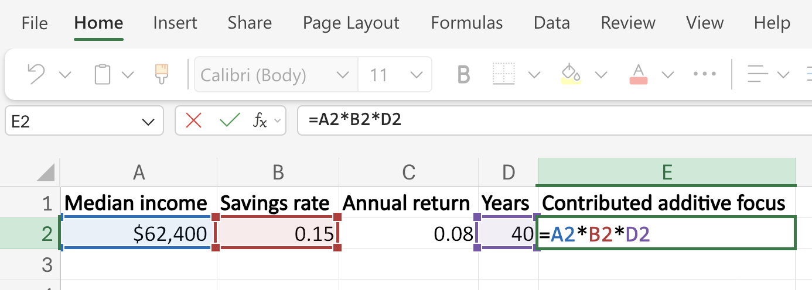
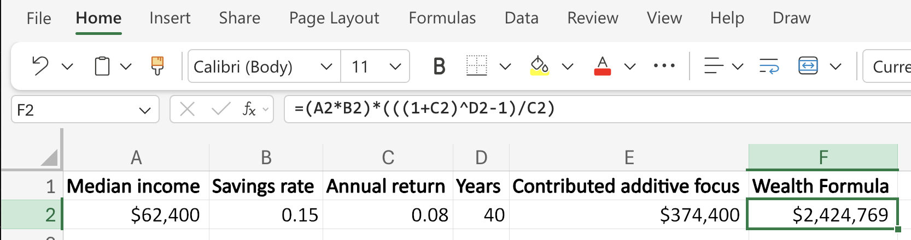
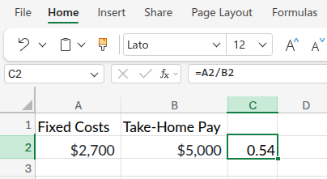
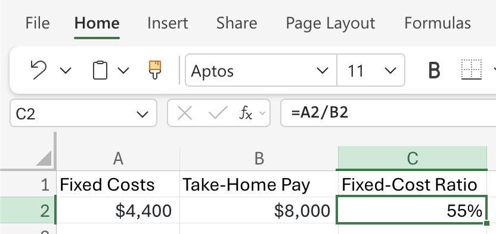
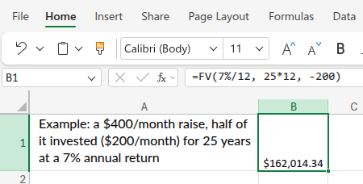

# Income

```{r}
#| label: setup-r
#| message: false
#| warning: false
#| include: false
source("_common.R")
```

```{python}
#| label: setup-py
#| include: false
```

<br>

Building wealth doesn't start with picking the right stock or finding a hot investment; it starts with how you manage the money flowing in and out of your life. Let's break down the foundational principles.

One thing to know before your first paycheck: your salary (gross pay) isn’t what lands in your bank account. Your employer first takes out federal and state income tax, Social Security and Medicare (7.65% combined), and anything you contribute to a 401(k) or health plan. What’s left is your take-home pay, the number you should plan around. On a $45,000 salary, take-home pay is often around $2,700 to $3,000 a month, depending on your state and benefits. The [Taxes](taxes.qmd) chapter explains each of these deductions.

## Some Core Truths

Here's a counterintuitive insight from Morgan Housel[^wealth]:

> "*Wealth is the nice cars not purchased. The diamonds not bought. The watches not worn, the clothes forgone and the first-class upgrade declined. Wealth is financial assets that haven’t yet been converted into the stuff you see.*" ([Morgan Housel](https://www.morganhousel.com/))

[^wealth]: [The Psychology of Money](https://www.goodreads.com/quotes/11756295-wealth-is-the-nice-cars-not-purchased-the-diamonds-not). Housel, Morgan. 2020.

The person driving the flashy car isn’t necessarily wealthy; they just spent their money on a car. True wealth is the income you *didn’t* spend, quietly compounding in the background.

[Ben Felix](https://rationalreminder.ca/) reinforces this with hard data. Research consistently shows that *conspicuous consumption (signaling wealth through purchases) is negatively correlated with actual wealth.*[^consp-consump] People who *look* rich usually aren’t, while the truly rich typically live below their income level.

[^consp-consump]: [Social class, social self-esteem, and conspicuous consumption](https://pmc.ncbi.nlm.nih.gov/articles/PMC7905187/#sec6). Oh, Ga-Eun (Grace). 2021.

## Your Human Capital

One of Felix's most powerful contributions is reframing how we think about income itself. He encourages investors to view themselves as having two forms of capital: human capital (your ability to earn money in the future) and financial capital (the money you've already saved and invested). When you're young, your single biggest asset is your future earning potential. 

```{mermaid}
%%| fig-cap: 'Human Capital'
%%| fig-align: center
%%{init: {'theme': 'neutral', 'themeVariables': { 'fontFamily': 'monospace', "darkMode":false, "fontSize":"16px"}}}%%

flowchart TD
    TotalWealth(["Your Total<br>Economic Wealth"]) --> HumanCapital("Human Capital:<br/>Future Earning Potential")
    TotalWealth --> FinancialCapital("Financial Capital:<br/>Investments & Savings")
    HumanCapital --> EarlyCareer("Early Career:<br/>Human Capital is HUGE")
    FinancialCapital --> EarlyCareer2("Early Career:<br/>Financial Capital is small")
    EarlyCareer --> Implication["Implication:<br>Invest in Skills,<br/>Education &<br>Career Growth"]
    EarlyCareer2 --> Implication2("Implication:<br>Take More Stock<br>Market Risk When Young")
    style TotalWealth fill:#48a56a,color:#F5F2E8,stroke:#1C1C1E,stroke-width:2px
    style HumanCapital fill:#0e9aa7,color:#F5F2E8,stroke:#1C1C1E,stroke-width:2px
    style FinancialCapital fill:#0e9aa7,color:#F5F2E8,stroke:#1C1C1E,stroke-width:2px
    style EarlyCareer fill:#0e9aa7,color:#F5F2E8,stroke:#1C1C1E,stroke-width:2px
    style EarlyCareer2 fill:#0e9aa7,color:#F5F2E8,stroke:#1C1C1E,stroke-width:2px
    style Implication fill:#86ddcd,color:#1C1C1E,stroke:#1C1C1E,stroke-width:2px
    style Implication2 fill:#86ddcd,color:#1C1C1E,stroke:#1C1C1E,stroke-width:2px

```

During this time, investing in skills, education, and career mobility will return more than any portfolio decision. Income growth, especially early in your career, is one of the most powerful wealth-building levers available. Time and energy spent developing valuable skills can pay off in later years (when these resources are less readily available).

## Spending and Happiness

The academic research on money and well-being tends to show some practical conclusions:

* [Experiences beat possessions.]{style="color:#48a56a; font-weight: bold;"} Research shows experiential purchases generate more lasting happiness than material ones.[^exp-poss] Choose a vacation or night out over new clothes or toys.

[^exp-poss]: [To do or to have? That is the question](https://doi.org/10.1037/0022-3514.85.6.1193). Van Boven, Leaf and Gilovich, Thomas. 2003.

* [Buying time is one of the highest-return uses of money.]{style="color:#48a56a; font-weight: bold;"} Outsourcing tasks you dislike (cleaning, lawn care, commuting time) correlates strongly with life satisfaction.[^buy-time] Real wealth should be measured in not doing things you don’t like to do (and more time spent doing things you like to do).

[^buy-time]: [Buying time promotes happiness](https://doi.org/10.1073/pnas.1706541114). Whillans, Ashley V. and Dunn, Elizabeth W. and Smeets, Paul and Bekkers, Rene and Norton, Michael I. 2017.

* [Lifestyle inflation is the silent killer.]{style="color:#f44242; font-weight: bold;"} Hedonic adaptation means each lifestyle upgrade quickly becomes the new baseline, but the financial commitment remains permanent.[^hedonic] This is the classic “keeping up with the Joneses” trap: avoid external comparisons of material wealth. Instead, focus on where you were last year (and where you’d like to be in the next year).

[^hedonic]: [If money doesn't make you happy, then you probably aren't spending it right](https://doi.org/10.1016/j.jcps.2011.02.002). Dunn, Elizabeth W. and Gilbert, Daniel T. and Wilson, Timothy D. 2011.

* [Housing is the biggest lever.]{style="color:#48a56a; font-weight: bold;"} Housing is usually your biggest expense, so choosing how much to spend on it greatly affects your wealth. Renting can be as good as (or better than) buying when you crunch the numbers.[^housing]

[^housing]: [Lessons from over 30 years of buy versus rent decisions: Is the American dream always wise?](https://doi.org/10.1111/j.1540-6229.2011.00321.x). Beracha, Eli and Johnson, Ken H. 2012. See also Ben Felix's analysis at [PWL Capital](https://pwlcapital.com/services/financial-wellness-coaching/) and the [Rational Reminder](https://rationalreminder.ca/) podcast.

## Three Anchoring Rules 

### 1. Sethi: "*Spend on What You Love, Cut on What You Don't*" {.unnumbered}

Love coffee? Buy the $6 latte. But maybe buy a reliable used car instead of leasing a luxury one. The goal isn’t deprivation; it’s intentionality.[^sethi-dials]

[^sethi-dials]: [I Will Teach You to Be Rich (2nd ed.)](https://www.hachettebookgroup.com/titles/ramit-sethi/i-will-teach-you-to-be-rich-second-edition/9781523505746/). Sethi, Ramit. 2019. The phrase "spend extravagantly on the things you love, and cut costs mercilessly on the things you don't" is the core of Sethi's "Conscious Spending Plan" (see Chapter 4, *Conscious Spending*). More at <https://www.iwillteachyoutoberich.com/>.

### 2. Housel: "*Build a Gap Between Ego and Income*" {.unnumbered}

The wider the gap between what you earn and what your ego demands you spend, the wealthier you become. Lifestyle creep silently kills financial freedom.[^housel-gap]

[^housel-gap]: [The Psychology of Money: Timeless Lessons on Wealth, Greed, and Happiness](https://www.harriman-house.com/psychologyofmoney). Housel, Morgan. 2020. The "gap between your ego and your income" framing appears in Chapter 10, *Save Money*. The chapter draws on Housel's earlier essay of the same name at [Collaborative Fund](https://collabfund.com/blog/the-psychology-of-money/).

### 3. Bogle: "*Keep It Simple*" {.unnumbered}

Bogle’s philosophy applies to spending, too: complexity is the enemy. The more complicated your financial life, the easier it is to lose track. Automate, simplify, repeat.[^bogle-simple]

[^bogle-simple]: [The Little Book of Common Sense Investing (10th Anniversary ed.)](https://www.wiley.com/en-us/The+Little+Book+of+Common+Sense+Investing%3A+The+Only+Way+to+Guarantee+Your+Fair+Share+of+Stock+Market+Returns%2C+10th+Anniversary+Edition-p-9781119404507). Bogle, John C. 2017. Bogle's recurring mantra ("Simplicity is the master key to financial success") runs throughout the book and his earlier *Common Sense on Mutual Funds*. The investor community he inspired distills these ideas at <https://www.bogleheads.org/wiki/Bogleheads%C2%AE_investment_philosophy>.

## Wealth vs Income

[Scott Galloway](https://www.profgalloway.com/), an NYU Stern professor and host of the Prof G podcasts, distills the whole problem into a single equation in his 2024 book *The Algebra of Wealth*:[^algebra-of-wealth]

[^algebra-of-wealth]: [The Algebra of Wealth: A Simple Formula for Financial Security](https://www.stern.nyu.edu/experience-stern/faculty-research/algebra-wealth-simple-formula-financial-security). Galloway, Scott. 2024. See [profgalloway.com](https://www.profgalloway.com/) for his writing, podcasts, and the weekly *No Mercy / No Malice* newsletter.

The **Wealth Formula**:

*Wealth = Focus + (Stoicism × Time × Diversification)*

The four variables are the four levers *you* actually control:

1. Focus: pick something economically valuable and become great at it. Career, geography, and skill choice compound harder than any single early financial decision. This is Galloway’s version of Felix’s human capital; [you build your earning engine first.]{style="color:#48a56a; font-weight: bold;"}

2. Stoicism: your willingness to live below your means, without needing to signal otherwise, will keep you from spending money you don’t have on things you don’t really need. Galloway, Housel, and Sethi all agree here; spending discipline is a character trait before it’s a budget.[^stoicism]

[^stoicism]: [Stoicism](https://plato.stanford.edu/entries/stoicism/). Durand, Marion and Shogry, Simon and Baltzly, Dirk. 2023.

3. Time: the most powerful financial variable is how many years of compounding you still have. The earlier you start, the more time you have.

4. Diversification: don’t bet on a single stock, sector, or career outcome. Spread risk across asset classes, geographies, and time.

```{mermaid}
%%| fig-cap: 'Wealth Formula'
%%| fig-align: center
%%{init: {'theme': 'neutral', 'themeVariables': { 'fontFamily': 'monospace', "darkMode":false, "fontSize":"16px"}}}%%

flowchart TD
    Wealth(["<strong>Wealth</strong>"]) --> Focus("Focus is <br><em>ADDITIVE</em>")
    Wealth --> SecondTerm("Second term is<br/><em>MULTIPLICATIVE</em><br>")
    
    SecondTerm --> Stoicism("<strong>STOICISM</strong><br>Living Below Means")
    SecondTerm --> Time("<strong>TIME</strong><br>Years Compounding")
    SecondTerm --> Diversification("<strong>DIVERSIFICATION</strong><br>Smart Allocation")
    
    Focus -.Standalone Contribution.-> SomeWealth(["<strong>FOCUS</strong><br>builds some wealth<br>even if others<br>fail"])
    
    Stoicism --> Multiply{"Multiply<br>Together"}
    Time --> Multiply
    Diversification --> Multiply
    Multiply --> Compounding(["<strong>Compounding<br>Wealth Engine</strong>"])
    
    style Wealth fill:#48a56a,color:#F5F2E8,stroke:#1C1C1E,stroke-width:2px
    style SecondTerm fill:#0e9aa7,color:#F5F2E8,stroke:#1C1C1E,stroke-width:2px
    style Stoicism fill:#0e9aa7,color:#F5F2E8,stroke:#1C1C1E,stroke-width:2px
    style Time fill:#0e9aa7,color:#F5F2E8,stroke:#1C1C1E,stroke-width:2px
    style Diversification fill:#0e9aa7,color:#F5F2E8,stroke:#1C1C1E,stroke-width:2px
    style Focus fill:#0e9aa7,color:#F5F2E8,stroke:#1C1C1E,stroke-width:2px
    
    style Compounding fill:#86ddcd,color:#1C1C1E,stroke:#1C1C1E,stroke-width:2px
    style SomeWealth fill:#86ddcd,color:#1C1C1E,stroke:#1C1C1E,stroke-width:2px
    style Multiply fill:#f0cfcf,color:#1C1C1E,stroke:#1C1C1E,stroke-width:2px

```


The arithmetic does a lot of the teaching on its own. Focus is [additive](https://en.wikipedia.org/wiki/Additive_function), meaning that even with poor execution on the other three, a strong income engine still builds wealth. 


However, stoicism, time, and diversification are [multiplicative](https://en.wikipedia.org/wiki/Multiplicative_function), so a zero on any one of these collapses the whole second term. 

In plain language: [spending above your means while not saving or investing for forty years compounds to nothing]{style="color:#f44242; font-weight: bold;"}.

The chart below illustrates this arithmetic. 

```{r}
#| label: wealth-formula-char-01
#| echo: false
#| fig-asp: 0.55 
#| message: false 
#| warning: false 
# Wealth formula: W = Focus + (Stoicism × Time × Diversification)
# For visualization, let's hold variables constant and vary time
# Focus = 50k (annual income)
# Stoicism = 0.6 (save 60% of income)
# Diversification = 1.08 (8% annual return)
# Time = years (0 to 40)

library(ggplot2)
library(tidyr)
library(dplyr)
years_seq <- seq(0, 40, by = 1)

# Parameters: median income, savings rate, annual return
median_income <- 62400
savings_rate <- 0.15
annual_return <- 0.08

# Create dataframe with breakdown
df <- data.frame(
  years = years_seq,
  annual_savings = median_income * savings_rate,
  focus_contribution = (median_income * savings_rate) * years_seq,
  multiplicative_contribution = (median_income * savings_rate) * (((1 + annual_return)^years_seq - 1) / annual_return)
)
df$total_wealth <- df$multiplicative_contribution

# Plot total wealth
ggplot(df, aes(x = years, y = total_wealth / 1e6)) +
  geom_line(linewidth = 1.2, color = "#0e9aa7") +
  geom_point(size = 2, color = "#0e9aa7") +
  scale_y_continuous(labels = function(x) paste0("$", x, "M")) +
  scale_x_continuous(breaks = seq(0, 40, by = 5)) +
  labs(
    title = "Wealth Growth: The Multiplicative Effect Dominates",
    subtitle = "Median income $62,400/year, 15% savings rate, 8% annual return",
    x = "Years",
    y = "Total Wealth"
  ) +
  theme_minimal(base_size = 12) +
  theme(
    panel.grid.minor = element_blank(),
    plot.title = element_text(face = "bold", size = 14)
  )
```


Focus contributes in a straight line (additive), while stoicism, time, and diversification compound exponentially. 

```{r}
#| label: wealth-formula-chart-02
#| echo: false
#| fig-cap: "Side-by-side comparison of multiplicative vs. additive growth"
#| fig-asp: 0.55
#| message: false 
#| warning: false 
years_seq <- seq(0, 40, by = 1)

df_decomposed <- data.frame(
  years = years_seq,
  focus = (median_income * savings_rate) * years_seq,
  multiplicative = (median_income * savings_rate) * (((1 + annual_return)^years_seq - 1) / annual_return)
)

df_long <- df_decomposed |>
  pivot_longer(cols = c(focus, multiplicative),
               names_to = "term",
               values_to = "wealth") |>
  mutate(
    term = factor(term, levels = c("focus", "multiplicative")),
    term_label = ifelse(term == "focus", 
                        "Additive: Focus",
                        "Multiplicative")
  )

ggplot(df_long, aes(x = years, y = wealth / 1e6, color = term)) +
  geom_line(linewidth = 1.2) +
  geom_point(data = df_long |> filter(years %% 10 == 0), size = 2.5) +
  facet_wrap(~term_label, scales = "free_y") +
  scale_color_manual(values = c("focus" = "#f44242", "multiplicative" = "#48a56a")) +
  scale_y_continuous(labels = function(x) paste0("$", x, "M")) +
  scale_x_continuous(breaks = seq(0, 40, by = 10)) +
  labs(
    title = "Additive vs Multiplicative: How They Grow Differently",
    x = "Years",
    y = "Contribution to Wealth",
    subtitle = "Median income $62,400/year, 15% savings rate, 8% annual return"
  ) +
  theme_minimal(base_size = 12) +
  theme(
    legend.position = "none",
    panel.grid.minor = element_blank(),
    plot.title = element_text(face = "bold", size = 14),
    strip.text = element_text(face = "bold", size = 9)
  )
```

After 40 years, the multiplicative term dominates the total.

```{r}
#| label: wealth-formula-chart-03
#| echo: false
#| fig-cap: "Wealth formula decomposed: additive (focus) vs multiplicative (stoicism × time × diversification)"
#| fig-asp: 0.55
#| message: false 
#| warning: false 

years_seq <- seq(0, 40, by = 1)

df_combined <- data.frame(
  years = years_seq,
  focus = (median_income * savings_rate) * years_seq,
  multiplicative = (median_income * savings_rate) * (((1 + annual_return)^years_seq - 1) / annual_return)
) |>
  dplyr::mutate(total = focus + multiplicative)

ggplot(df_combined, aes(x = years)) +
  geom_area(aes(y = focus / 1e6, fill = "Focus (Additive)"), alpha = 0.6) +
  geom_area(aes(y = (focus + multiplicative) / 1e6, fill = "Stoicism × Time × Diversification"), alpha = 0.6) +
  geom_line(aes(y = focus / 1e6), color = "#f44242", linewidth = 1.3, linetype = "solid") +
  geom_line(aes(y = total / 1e6), color = "#1C1C1E", linewidth = 1.2) +
  scale_fill_manual(
    values = c("Focus (Additive)" = "#f44242", 
               "Stoicism × Time × Diversification" = "#48a56a"),
    guide = guide_legend(reverse = TRUE)
  ) +
  scale_y_continuous(labels = function(x) paste0("$", x, "M")) +
  scale_x_continuous(breaks = seq(0, 40, by = 5)) +
  labs(
    x = "Years", 
    y = "Total Wealth",
    fill = NULL,
    subtitle = "Median income $62,400/year, 15% savings rate, 8% annual return"
  ) +
  theme_minimal(base_size = 12) +
  theme(
    panel.grid.minor = element_blank(),
    legend.position = "bottom",
    legend.text = element_text(size = 10)
  )
```

The illustration uses concrete assumptions: median income of $62,400, saving 15% yearly ($9,360, stoicism), and earning 8% annually (diversification). The red area grows linearly. The green area curves upward, eventually dwarfing the red. This is the power of compound growth.

## As Your Income Grows

This is where most people fail. A raise feels like permission to upgrade everything. Instead, focus on Felix's research-backed advice: *the extra happiness from each lifestyle upgrade is much smaller than people expect, while the extra financial security from saving raises is enormous.*

```{mermaid}
%%| fig-cap: 'Raise Diagram'
%%| fig-align: center
%%{init: {'theme': 'neutral', 'themeVariables': { 'fontFamily': 'monospace', "darkMode":false, "fontSize":"16px"}}}%%

flowchart TD
    Raise(["Pay Raise"]) --> Split{"<strong>Split the Raise</strong>"}
    Split --> HalfInvest["50% to<br>Investing/Savings"]
    Split --> HalfLifestyle["50% to<br>Lifestyle"]
    HalfInvest --> WealthGrows(["Wealth Compounds"])
    HalfLifestyle --> EnjoyNow(["Enjoy the Win"])
    
    style Raise fill:#48a56a,color:#F5F2E8,stroke:#1C1C1E,stroke-width:2px
    style Split fill:#f0cfcf,color:#1C1C1E,stroke:#1C1C1E,stroke-width:2px
    style HalfInvest fill:#0e9aa7,color:#F5F2E8,stroke:#1C1C1E,stroke-width:2px
    style HalfLifestyle fill:#0e9aa7,color:#F5F2E8,stroke:#1C1C1E,stroke-width:2px
    style WealthGrows fill:#86ddcd,color:#1C1C1E,stroke:#1C1C1E,stroke-width:2px
    style EnjoyNow fill:#86ddcd,color:#1C1C1E,stroke:#1C1C1E,stroke-width:2px
```

This way, you reward yourself *and* accelerate freedom, without falling into the trap of inflating your lifestyle to match every dollar.

## Math for Income {#math-for-income}

This chapter is mostly about behavior, but I'll cover some numbers below that can turn the behaviors into something you can track. Each calculation below is also written as an R and Python function, which are covered in the callout box below.


::::::: {.callout-note collapse="true" appearance="default" icon=false}

## R vs Python: assignment and functions

The first two differences you'll see between R and Python in this book are how each language *names* things and how each language *defines functions*.

**Assignment**

::: {layout="[50,50]" layout-valign="top"}
R uses `<-` by convention (`=` also works).

Python uses `=`.
:::

::: {layout="[50,50]" layout-valign="top"}
``` r
x <- 10
```

``` python
x = 10
```
:::

**Function definition**

::: {layout="[50,50]" layout-valign="top"}
R uses `function()` and assigns the result to a name. The body is wrapped in curly braces `{}`.

Python uses the `def` keyword, followed by a colon and an indented body.
:::

::: {layout="[50,50]" layout-valign="top"}
``` r
add_fun <- function(a, b) {
  a + b
}
```

``` python
def add_fun(a, b):
    return a + b
```
:::
:::::::

### The Wealth Formula {.unnumbered}

Galloway's wealth formula captures the essence of wealth building. To turn it into numbers, picture someone earning \$62,400 a year, about the median for full time workers in 2025 ([BLS](https://www.bls.gov/opub/ted/2026/median-weekly-earnings-were-1204-in-2025.htm): \$1,204 a week). Your first paycheck will probably be smaller; think of this as an average over a career. They save 15% (\$9,360) every year and earn 8%. Each bar below is their savings at a checkpoint, split into what they put in and what it grew into.

```{r}
#| label: wealth-bar-model
#| echo: false
#| fig-cap: "$9,360 saved every year at 8%: money put in vs. growth"
#| fig-asp: 0.50
library(ggplot2)
yrs <- c(10, 20, 30, 40)
put_in <- 9360 * yrs
total  <- 9360 * ((1.08^yrs - 1) / 0.08)
df_w <- data.frame(
  year   = factor(rep(paste0("Year ", yrs), 2), levels = paste0("Year ", yrs)),
  layer  = factor(rep(c("Growth", "Money put in"), each = 4),
                  levels = c("Growth", "Money put in")),
  amount = c(total - put_in, put_in)
)
ggplot(df_w, aes(x = year, y = amount, fill = layer)) +
  geom_col(width = 0.6, colour = "#1C1C1E", linewidth = 0.4) +
  geom_text(
    data = data.frame(year = factor(paste0("Year ", yrs), levels = paste0("Year ", yrs)), total = total),
    aes(x = year, y = total,
        label = paste0("$", formatC(round(total / 1000), format = "d", big.mark = ","), "k")),
    inherit.aes = FALSE, vjust = -0.4, fontface = "bold", size = 3.5
  ) +
  scale_fill_manual(values = c("Money put in" = "#0e9aa7", "Growth" = "#48a56a")) +
  scale_y_continuous(
    limits = c(0, max(total) * 1.12),
    labels = function(x) paste0("$", formatC(round(x / 1000), format = "d", big.mark = ","), "k")
  ) +
  labs(x = NULL, y = NULL, fill = NULL) +
  theme_minimal(base_size = 12) +
  theme(
    legend.position    = "top",
    panel.grid.major.x = element_blank(),
    panel.grid.minor   = element_blank()
  )
```

The blue layer grows in a straight line, one \$9,360 deposit per year. The green layer is every deposit growing at 8% for the years it has left, and it passes the blue layer after about year 18. Adding up all those growing deposits is what the formula's second term does. Each piece of Galloway's formula has a place in the math: your income and savings rate set the yearly deposit (stoicism), the number of years is time, and the return is what diversified investing earns.

**Formula:** Wealth after *n* years = Yearly savings × [((1 + r)\^n − 1) ÷ r]

  * *Where*: Yearly savings = Income × Savings rate, *r* = the yearly return, and *n* = the number of years.

**Example**: \$62,400 × 15% = \$9,360 a year. \$9,360 × [((1.08)\^40 − 1) ÷ 0.08] = [about \$2,424,769 after 40 years.]{style="color:#48a56a; font-weight: bold;"} 

**Check**: you put in \$9,360 × 40 = \$374,400, so growth did most of the work.

::: panel-tabset

## Excel

In Excel, we can break this into two columns for clarity. Let's say we have:

* `A2`: median income ($62,400)   
* `B2`: savings rate (0.15)   
* `C2`: annual return (0.08)    
* `D2`: years (40)    

For the total contributed (the additive focus) in cell `E2`:

```swift
=A2*B2*D2
```

{width='75%' fig-align='center'}

For total wealth, contributions plus growth, in cell `F2`:

```swift
=(A2*B2)*(((1+C2)^D2-1)/C2)
```

`F2` already includes everything in `E2`, so don't add the two together.

{width='75%' fig-align='center'}

## Python

The Python version of `wealth_formula()` works the same way:

```{python}
#| label: wealth-formula-py
def wealth_formula(median_income, savings_rate, annual_return, years):
    # future value of saving a fixed amount every year (contributions plus growth)
    annual_savings = median_income * savings_rate
    return annual_savings * (((1 + annual_return)**years - 1) / annual_return)
```

After 40 years with median income, 15% savings rate, 8% return:

```{python}
#| label: wealth-formula-py-apply
wealth_formula(
    median_income=62400,
    savings_rate=0.15,
    annual_return=0.08,
    years=40
)
```

## R

In R, `wealth_formula()` returns the future value of saving a fixed amount every year.

```{r}
#| label: wealth-formula-r
wealth_formula <- function(median_income, savings_rate, annual_return, years) {
  # future value of saving a fixed amount every year (contributions plus growth)
  annual_savings <- median_income * savings_rate
  annual_savings * (((1 + annual_return)^years - 1) / annual_return)
}
```

After 40 years with median income, 15% savings rate, 8% return:

```{r}
#| label: wealth-formula-r-apply
wealth_formula(
  median_income = 62400,
  savings_rate = 0.15,
  annual_return = 0.08,
  years = 40
)
```

:::

The result is approximately \$2.4 million after 40 years, of which only \$374,400 is money you contributed. This is a powerful demonstration of how modest, consistent saving paired with compound growth transforms modest income into substantial wealth.

### The Fixed-Cost Ratio {.unnumbered}

Fixed costs (rent, loan payments, insurance, utilities) are the commitments you can't easily change month to month. Take-home pay is what actually lands in your bank account after taxes and other deductions. Picture a first job with \$3,200 of take-home pay a month and \$1,760 of fixed costs. The bar below is that paycheck cut into 10 equal pieces of \$320 (each piece is 10%), with the fixed costs shaded and the 60% ceiling that keeps the rest of the budget healthy marked.

```{r}
#| label: fixed-cost-bar-model
#| echo: false
#| fig-cap: "$3,200 take-home pay in 10 units of $320: fixed costs vs. flexible spending"
#| fig-asp: 0.30
library(ggplot2)
parts <- c("Fixed costs ($1,760)", "Flexible spending ($1,440)")
df_fc <- data.frame(
  part   = factor(parts, levels = rev(parts)),
  amount = c(1760, 1440),
  bar    = "Take-home pay"
)
ggplot(df_fc, aes(x = amount, y = bar, fill = part)) +
  geom_col(width = 0.5, colour = "#1C1C1E", linewidth = 0.4) +
  geom_vline(xintercept = seq(320, 2880, by = 320), colour = "white", linewidth = 0.5) +
  geom_vline(xintercept = 1920, colour = "#1C1C1E", linetype = "dashed", linewidth = 1) +
  annotate("text", x = 1920, y = 1.42, label = "60% ceiling: $1,920",
           fontface = "bold", size = 3.4, hjust = -0.05) +
  scale_fill_manual(values = c("Fixed costs ($1,760)" = "#f44242",
                               "Flexible spending ($1,440)" = "#86ddcd"),
                    breaks = parts) +
  scale_x_continuous(breaks = seq(0, 3200, by = 640),
                     labels = function(x) paste0("$", formatC(x, format = "d", big.mark = ","))) +
  scale_y_discrete(expand = expansion(add = c(0.4, 0.6))) +
  labs(x = NULL, y = NULL, fill = NULL) +
  theme_minimal(base_size = 12) +
  theme(
    legend.position    = "top",
    panel.grid.major.y = element_blank(),
    panel.grid.minor   = element_blank(),
    axis.text.y        = element_blank()
  )
```

The red section covers 5 and a half of the 10 pieces, so fixed costs take 55% of the paycheck. The formula does the same thing: divide the red section by the whole bar, then multiply by 100.

**Formula:** Fixed-Cost Ratio = Fixed Costs ÷ Take-Home Pay × 100

  * *Where*: Fixed Costs = the monthly commitments you can't easily change (rent, loan payments, insurance, utilities), and Take-Home Pay = what lands in your bank account after taxes and other deductions.

**Example**: \$1,760 ÷ \$3,200 × 100 = [55%.]{style="color:#48a56a; font-weight: bold;"}

**Check**: the ceiling is 60% of \$3,200 = \$1,920, and \$1,760 is below it.

::: panel-tabset

## Excel

In Excel there's no function to define: you put the numbers in cells and write the formula once. Enter the fixed costs in cell `A2` and take-home pay in `B2`, then in `C2`:

```swift
=A2/B2
```

That gives `0.55`. 

{width='75%' fig-align='center'}

Format `C2` as a percentage (`Home → %`, or `Ctrl+Shift+5`) and it displays [55%]{style="color:#48a56a; font-weight: bold;"}.

{width='75%' fig-align='center'}

To produce the percent *string* directly (the analog of R's `paste0(..., "%")` and Python's f-string), use `TEXT()` instead:

```swift
=TEXT(A2/B2, "0.0%")
```

{width='75%' fig-align='center'}

## Python

The same formula in Python:

```{python}
#| label: fixed-cost-py
def fixed_cost_ratio(fixed_costs, take_home):
    return (fixed_costs / take_home) * 100

```

\$1,760 of fixed costs on \$3,200 take-home pay

```{python}
#| label: fixed-cost-py-apply
fixed_cost_ratio(fixed_costs=1760, take_home=3200)
```

## R

Below is an implementation of this function in R:

```{r}
#| label: fixed-cost-r
fixed_cost_ratio <- function(fixed_costs, take_home) {
  (fixed_costs / take_home) * 100
}
```

\$1,760 of fixed costs on \$3,200 take-home pay

```{r}
#| label: fixed-cost-r-apply
fixed_cost_ratio(fixed_costs = 1760, take_home = 3200)
```

:::

This results in a 55% fixed-cost ratio, just under the ceiling!

### What a Raise Is Really Worth {.unnumbered}

Say you get a raise that adds \$400 a month to your take-home pay, and you follow the split from the diagram above: \$200 goes to your lifestyle and \$200 gets invested. \$200/month doesn't sound like much. The chart below shows what that single habit produces when invested at 7% over 25 years, split into the money you put in and what it grew into.

```{r}
#| label: raise-value-bar-model
#| echo: false
#| fig-cap: "$200/month invested at 7%: value at each 5-year checkpoint"
#| fig-asp: 0.50
library(ggplot2)
yrs  <- c(5, 10, 15, 20, 25)
vals <- round(200 * (((1 + 0.07 / 12)^(yrs * 12) - 1) / (0.07 / 12)))
df_raise <- data.frame(
  year  = factor(paste0("Year ", yrs), levels = paste0("Year ", yrs)),
  value = vals
)
df_layers <- data.frame(
  year   = rep(df_raise$year, 2),
  layer  = factor(rep(c("Growth", "Money put in"), each = length(yrs)),
                  levels = c("Growth", "Money put in")),
  amount = c(vals - 200 * 12 * yrs, 200 * 12 * yrs)
)
ggplot(df_raise, aes(x = year, y = value)) +
  geom_col(data = df_layers, aes(x = year, y = amount, fill = layer),
           width = 0.6, colour = "#1C1C1E", linewidth = 0.4, inherit.aes = FALSE) +
  scale_fill_manual(values = c("Money put in" = "#0e9aa7", "Growth" = "#48a56a")) +
  geom_text(
    aes(label = paste0("$", formatC(round(value / 1000), format = "d",
                                    big.mark = ","), "k")),
    vjust = -0.4, fontface = "bold", size = 3.5
  ) +
  scale_y_continuous(
    limits = c(0, max(vals) * 1.2),
    labels = function(x) paste0("$", round(x / 1000), "k")
  ) +
  labs(x = NULL, y = NULL, fill = NULL,
       subtitle = "$200/month invested at 7% annual return") +
  theme_minimal(base_size = 12) +
  theme(
    legend.position    = "top",
    panel.grid.major.x = element_blank(),
    panel.grid.minor   = element_blank()
  )
```

Each bar is the previous total plus another year of \$200/month contributions and their growth; the future value formula adds up all those monthly deposits, each with its own growth, in one calculation.

**Formula:** FV = PMT × [((1 + r)\^n − 1) ÷ r]

  * *Where*: PMT is the amount invested each month, *r* is the monthly return, and *n* is the number of months.

We will revisit this future-value-of-contributions formula in the [Investing Basics](investing_basics.qmd) chapter.

**Example**: \$200 × [((1 + 0.07 ÷ 12)\^300 − 1) ÷ (0.07 ÷ 12)] = [about \$162,014 after 25 years (300 months).]{style="color:#48a56a; font-weight: bold;"}

**Check**: you put in \$200 × 300 = \$60,000, so growth added about \$102,000.

::: panel-tabset

## Excel

Excel actually has a built-in [`FV()` (future value) function](https://support.microsoft.com/en-US/Excel/fv-function), so we don't have to write the formula ourselves. The arguments are `FV(rate, nper, pmt)`:

* `rate` is the return *per period* (monthly here): `7%/12`     
* `nper` is the number of periods: `25*12`      
* `pmt` is the amount invested each period, entered as a *negative* number because it's cash leaving your pocket: `-200`      

```swift
=FV(7%/12, 25*12, -200)
```

{width='75%' fig-align='center'}

This returns [\$162,014.34]{style="color:#48a56a; font-weight: bold;"}, the same result as the R and Python functions above. (Excel reports a positive number because the contributions were entered as negative cash flows.)

## Python

Below is the same function in Python:

```{python}
#| label: raise-value-py
def raise_invested_value(monthly_raise, invest_share, rate, years):
    contribution = monthly_raise * invest_share
    monthly_rate = rate / 12
    periods = years * 12
    return contribution * (((1 + monthly_rate) ** periods - 1) / monthly_rate)
```

Half of a \$400/month raise, invested for 25 years at 7%

```{python}
#| label: raise-value-py-apply
raise_invested_value(monthly_raise=400, invest_share=0.5, rate=0.07, years=25)
```

## R

Here is an example of this function in R:

```{r}
#| label: raise-value-r
raise_invested_value <- function(monthly_raise, invest_share, rate, years) {
  contribution <- monthly_raise * invest_share
  monthly_rate <- rate / 12
  periods      <- years * 12
  contribution * (((1 + monthly_rate)^periods - 1) / monthly_rate)
}
```

Half of a \$400/month raise, invested for 25 years at 7%

```{r}
#| label: raise-value-r-apply
raise_invested_value(
  monthly_raise = 400, 
  invest_share = 0.5, 
  rate = 0.07, 
  years = 25)
```

:::

We can see this results in over \$160K! 

## Recap

1. [Invest in your human capital]{style="color:#48a56a; font-weight: bold;"}: your career is your biggest asset early on, and it’s the focus part of the wealth equation.

2. [Track your fixed costs]{style="color:#48a56a; font-weight: bold;"}: aim to keep them under 60% of your take-home pay. Stoicism aligns with Housel’s “*gap between ego and income.*” Living within your means isn’t about restriction; it’s about control and intention.

3. [Spend the rest without guilt]{style="color:#48a56a; font-weight: bold;"} on what genuinely brings you joy: prioritize experiences and time over possessions. As Housel puts it, the highest form of wealth is the ability to wake up and say, “*I can do whatever I want today.*”

4. [Keep it simple]{style="color:#48a56a; font-weight: bold;"}: Bogle’s philosophy is portfolio-level diversification, and time is on the side of compounding (which we will return to in [Investing](investing.qmd)).

Wealth comes from growing your income, protecting your savings, and spending money on what actually makes you happy.

The next chapter turns to the other side of income: tracking where your money actually goes.


